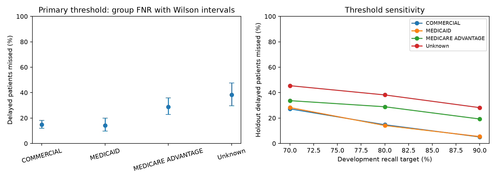

# WiDS 2024 diagnosis prediction and insurance group reliability

Predict timely diagnosis, then ask who the model misses. This project completes the WiDS Datathon 2024 Challenge 1 task and examines delayed-patient errors across recorded insurance groups.

## The analysis in order

| Step | Question | Where to read it |
| --- | --- | --- |
| Understand the data | What is missing, and who is represented? | [01 Data exploration](notebooks/01_data_exploration.ipynb) |
| Build the competition model | Can the supplied features rank timely diagnosis? | [02 Prediction](notebooks/02_prediction_model.ipynb) |
| Audit errors | Does the same threshold miss different shares of delayed patients? | [03 Insurance audit](notebooks/03_insurance_audit.ipynb) |
| Investigate and review | Are patterns stable, and does one threshold change improve them without extra false alarms? | [Audit report](reports/insurance_audit.md) |

The notebooks show these steps and their results. Shared calculation functions live in two plain Python scripts; function implementations are not copied into notebooks. No application service, configuration framework or automatic clinical approval system is included.

## Main results

- Competition development OOF AUC: **0.7990**; original holdout AUC: **0.7943**. These are local scores, not Kaggle leaderboard scores.
- At the global threshold targeting 80% development delayed recall, holdout FNR is 14.7% for COMMERCIAL, 14.1% for MEDICAID, 28.9% for MEDICARE ADVANTAGE and 38.2% for Unknown insurance.
- A development-defined group-threshold candidate shrinks the group FNR gap from 24.1 to 8.2 percentage points, but adds 22 false alarms and 4 missed delays. **Do not adopt that candidate under the stated research comparison checks.**



The [technical report](reports/technical_report.md) explains prediction validation. The [audit report](reports/insurance_audit.md) follows the full check, investigation, change, recheck and decision sequence, including denominators and uncertainty.

## Reproduce

The recorded environment is Python 3.14. Install `python -m pip install -r requirements.txt`, then place the competition files in `input/` as described in [the data instructions](input/README.md).

Run the three notebooks in numbered order, or run these two commands from the repository root:

```bash
python src/analysis.py
python src/insurance_audit.py
```

The first command explores data, compares two fixed CatBoost configurations, evaluates the selected model and generates the local submission. It also saves patient-aligned development and holdout probabilities. The second command reads those artifacts, audits errors, tests one threshold candidate and records the decision. It never trains a model; missing artifacts produce an instruction to run the first step.

Raw data, patient probabilities, split indices and submissions stay local and are ignored by Git. Only code, reports and aggregate results are included.

## Limits

The target is timely diagnosis, not cancer incidence or timely treatment. Diagnostic field timestamps are unverified. The audit reuses a previously inspected holdout and is post hoc; it is not independent confirmation, proof of discrimination or clinical validation. Missing insurance does not mean uninsured. Relative comparison checks are research choices, not hospital-approved safety limits.

## Repository structure

```text
input/          Data acquisition instructions and ignored local CSVs
notebooks/      Three ordered research notebooks
src/            Prediction and insurance audit functions
reports/        Two reports, figures and aggregate tables
submissions/    Local submission instructions
scores.csv      Development fold scores
requirements.txt
README.md
```

## References and attribution

- [WiDS Datathon 2024 Challenge 1](https://www.kaggle.com/competitions/widsdatathon2024-challenge1): task, dataset and scoring specification.
- [WiDS exploratory analysis tutorial](https://www.widsworldwide.org/get-inspired/blog/triple-negative-breast-cancer-datathon-a-tutorial/): exploratory analysis workflow.
- [MathWorks diagnosis prediction tutorial](https://blogs.mathworks.com/student-lounge/2024/01/01/predicting-timely-diagnosis-of-metastatic-breast-cancer-for-the-wids-datathon-2024/): end-to-end baseline workflow.
- Locally supplied notebooks `wids-datathon-catboost.ipynb`, `wids2024-acwomen-catboost.ipynb`, and `wids-kaggle-2024.ipynb`: methodological references for CatBoost, stratified validation, and probability averaging. Their author identities, original URLs and reuse licenses were not supplied; no authorship or leaderboard rank is inferred from filenames. Their code is not redistributed.
- [Repository organization reference](https://github.com/shashankhs11/ubc-wids-nov2024): folder organization only; its rental-market analysis is a different project.

The analysis implementation and insurance audit in this repository were developed for this project with Codex assistance. Reference results are not represented as this project's results.
