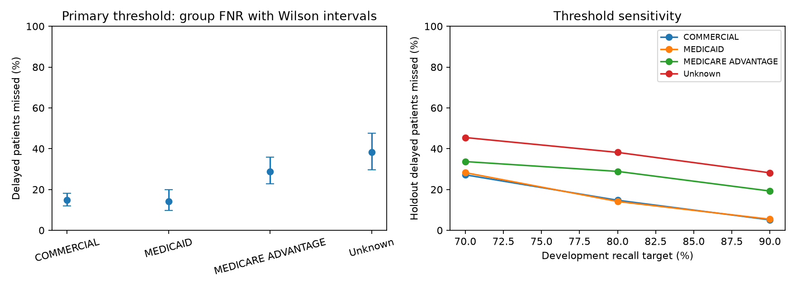
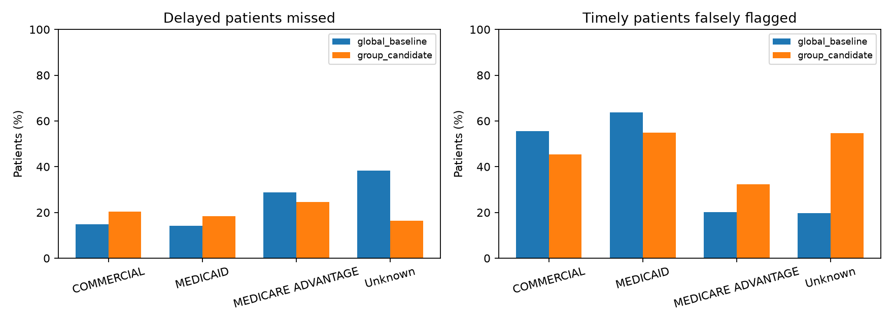

# Who the diagnosis model misses

## Question and measurement

Does the fixed competition model miss different shares of delayed patients across recorded insurance groups? The competition predicts timely diagnosis. For this audit, delayed=1-DiagPeriodL90D and delay risk=1-predicted timely probability.

A false negative is an actually delayed patient not flagged as delayed. FNR divides those misses by actual delayed patients. A false positive is an actually timely patient flagged as delayed, not a false cancer diagnosis. Unknown insurance remains a missing recording state.

The sequence is: check errors, investigate their stability, test one change, repeat the checks, and record a decision. This is a retrospective analysis of an already-inspected holdout. All threshold choices below use development OOF probabilities; model parameters and probabilities are fixed.

## 1. Check the baseline

Set one global threshold from development delayed patients to target 80% recall. Use the same threshold for every group. Targets of 70% and 90% check sensitivity; 80% is an audit choice, not a clinical standard.

| insurance | patients | delayed | false_negative | fnr | fnr_low | fnr_high | fpr | auc |
| --- | --- | --- | --- | --- | --- | --- | --- | --- |
| COMMERCIAL | 1214 | 489 | 72 | 0.1472 | 0.1186 | 0.1814 | 0.5559 | 0.7980 |
| MEDICAID | 507 | 184 | 26 | 0.1413 | 0.0983 | 0.1990 | 0.6378 | 0.7699 |
| MEDICARE ADVANTAGE | 506 | 187 | 54 | 0.2888 | 0.2286 | 0.3575 | 0.2006 | 0.8106 |
| Unknown | 355 | 110 | 42 | 0.3818 | 0.2965 | 0.4751 | 0.1959 | 0.7698 |

Rates are fractions. FNR limits are 95% Wilson intervals, which assume independent binomial observations and do not account for geography. MEDICARE ADVANTAGE has higher group AUC than COMMERCIAL but higher FNR at this threshold: ranking quality alone does not determine operating-point errors.

## 2. Investigate the pattern

The threshold tradeoff is visible in the overall rates:

| target_development_recall | recall | fnr | fpr | precision |
| --- | --- | --- | --- | --- |
| 0.7000 | 0.6928 | 0.3072 | 0.2550 | 0.6205 |
| 0.8000 | 0.8000 | 0.2000 | 0.4473 | 0.5184 |
| 0.9000 | 0.8948 | 0.1052 | 0.6892 | 0.4386 |

For group-minus-COMMERCIAL differences, resample ZIP-prefix clusters 1,000 times with the model and threshold fixed. COMMERCIAL is a reference, not a fairness ideal:

| insurance | fnr_difference | low | high |
| --- | --- | --- | --- |
| COMMERCIAL | 0.0000 | 0.0000 | 0.0000 |
| MEDICAID | -0.0059 | -0.0595 | 0.0536 |
| MEDICARE ADVANTAGE | 0.1415 | 0.0677 | 0.2200 |
| Unknown | 0.2346 | 0.1356 | 0.3344 |

The MEDICARE ADVANTAGE and Unknown intervals are above zero in this exploratory audit. This does not establish discrimination or an insurance effect. Intervals are not adjusted for multiple comparisons and exclude retraining and threshold-estimation uncertainty.

As a coding-pattern sensitivity check, keep the same threshold within C-prefixed and numeric-only diagnosis strings:

| coding_family | insurance | patients | delayed | false_negative | fnr | small_delayed_count |
| --- | --- | --- | --- | --- | --- | --- |
| C-prefixed | COMMERCIAL | 911 | 211 | 72 | 0.3412 | False |
| C-prefixed | MEDICAID | 401 | 89 | 26 | 0.2921 | False |
| C-prefixed | MEDICARE ADVANTAGE | 382 | 79 | 54 | 0.6835 | False |
| C-prefixed | Unknown | 293 | 57 | 42 | 0.7368 | False |
| Numeric-only | COMMERCIAL | 303 | 278 | 0 | 0.0000 | False |
| Numeric-only | MEDICAID | 106 | 95 | 0 | 0.0000 | False |
| Numeric-only | MEDICARE ADVANTAGE | 124 | 108 | 0 | 0.0000 | False |
| Numeric-only | Unknown | 62 | 53 | 0 | 0.0000 | False |

These strings are not verified dates or clinical cohorts. All numeric-only patients are flagged at this threshold, including timely patients. Within the C-prefixed stratum, MEDICARE ADVANTAGE and Unknown still have higher observed FNR than COMMERCIAL. This is not causal adjustment; age, clinical case mix, geography and recording practices remain possible explanations. Cells with fewer than 30 delayed cases are flagged as small.

## 3. Test one change

Use a separate threshold for each recorded insurance group, each targeting 80% delayed recall in development OOF data. Groups with fewer than 30 development delayed cases, or unseen groups, use the global fallback. The rule is not searched against holdout outcomes. This count safeguard does not guarantee accurate thresholds.

Before evaluating this candidate, set three relative research checks: smaller max-minus-min group FNR gap, no higher worst-group FNR, and no higher overall FPR. These are transparent comparison choices, not hospital-approved acceptance limits. Model probabilities, AUC, Brier score and competition submission remain unchanged.

## 4. Recheck benefits and costs

| policy | false_negative | false_positive | fnr | fpr | fnr_gap | worst_group_fnr |
| --- | --- | --- | --- | --- | --- | --- |
| global_baseline | 194 | 721 | 0.2000 | 0.4473 | 0.2405 | 0.3818 |
| group_candidate | 198 | 743 | 0.2041 | 0.4609 | 0.0824 | 0.2460 |

| insurance | baseline_fnr | candidate_fnr | baseline_fpr | candidate_fpr |
| --- | --- | --- | --- | --- |
| COMMERCIAL | 0.1472 | 0.2045 | 0.5559 | 0.4538 |
| MEDICAID | 0.1413 | 0.1848 | 0.6378 | 0.5480 |
| MEDICARE ADVANTAGE | 0.2888 | 0.2460 | 0.2006 | 0.3229 |
| Unknown | 0.3818 | 0.1636 | 0.1959 | 0.5469 |

The group FNR gap falls from 24.05 to 8.24 percentage points. But false alarms rise by 22, and missed delays rise by 4. Some groups improve while others worsen.

| check | baseline | candidate | passed |
| --- | --- | --- | --- |
| Smaller group FNR gap | 0.2405 | 0.0824 | True |
| No higher worst-group FNR | 0.3818 | 0.2460 | True |
| No higher overall FPR | 0.4473 | 0.4609 | False |

Paired ZIP-cluster-bootstrap changes below are candidate minus baseline, with negative values indicating lower rates:

| metric | candidate_minus_baseline | low | high |
| --- | --- | --- | --- |
| fnr_gap | -0.1582 | -0.2746 | -0.0175 |
| worst_group_fnr | -0.1358 | -0.2342 | -0.0389 |
| fpr | 0.0136 | -0.0084 | 0.0347 |

The observed FPR increase is uncertain: its interval includes zero. That does not establish a cost-free improvement. These intervals condition on fitted thresholds and reuse the inspected holdout; they are not an independent confirmation.

## 5. Record the decision

**Do not adopt this candidate under the stated relative research checks.** It fails the no-higher-overall-FPR check. Keep the original global threshold as a research baseline, not a clinically approved policy. The [decision record](tables/insurance_review_decision.json) is regenerated with the tables and figures by `python src/insurance_audit.py`.

This closes the project-level review: an unsuccessful change is documented rather than followed by an automatic search for a favorable result. Future business acceptance would require verified feature timestamps, an independent population, and domain-agreed costs for missed delays and false alarms. The current analysis does not establish screening-time usability, treatment benefit, or a causal insurance effect.

## Reproduce and sources

Run [notebook 03](../notebooks/03_insurance_audit.ipynb) after notebook 02, or run `python src/insurance_audit.py` after `python src/analysis.py`. The audit reads patient-aligned artifacts and never retrains a model. Detailed counts and all sensitivity results remain in `reports/tables/`; patient-level probabilities are ignored by Git.

- [Fairlearn](https://github.com/fairlearn/fairlearn/blob/main/README.rst): group performance assessment.
- [Aequitas](https://github.com/dssg/aequitas/blob/master/README.md): confusion-matrix-based auditing. Metrics are calculated directly here using existing dependencies.
- [Same-competition analysis](https://github.com/eugenee726/wids2024-metastatic-cancer/blob/main/README.md): attention to diagnosis coding; its findings and imputation methods are not treated as our evidence.
