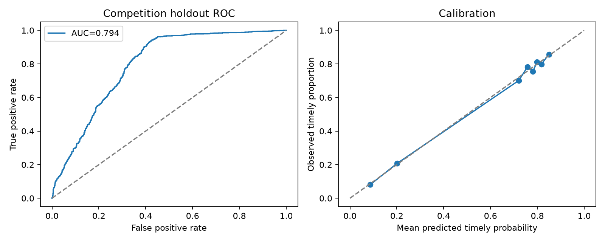

# Timely diagnosis prediction

## Question and data

Predict DiagPeriodL90D=1: diagnosis within the competition's 90-day window. There are 12,906 labeled patients and 5,792 test patients. Patient IDs are unique and disjoint across the supplied files; test IDs match the submission template.

[Missingness](tables/missingness.csv) and [insurance descriptions](tables/insurance_descriptive.csv) describe the records. Area characteristics are not individual characteristics. Keep categorical missingness Unknown and numerical NaN for CatBoost. Add missing indicators for BMI, race and payer. ZIP prefix is categorical. Exclude patient ID, constant gender and the two extremely sparse novel-treatment columns. No external medical-code mapping is applied.

## Development and evaluation

Use a fixed stratified 80/20 split with seed 42. Compare two fixed CatBoost configurations using five development folds. Select by pooled OOF AUC, then fit the selected configuration on development patients and evaluate the original holdout. Neither preprocessing nor selection uses holdout statistics. [Fold scores](../scores.csv) and [selected settings](tables/model_settings.json) preserve the choices.

The selected setting is 150 iterations, depth 3, learning rate 0.08 and L2 regularization 5. Development OOF AUC is 0.799016; holdout AUC is 0.794339. The patient-bootstrap AUC interval is 0.7754–0.8131; Brier score is 0.1510. The interval conditions on this fitted model and excludes training uncertainty and shared-area dependence.

[Feature importance](tables/competition_importance.csv) describes model reliance, not causal effects. Diagnostic codes and descriptions dominate it. This helps motivate checking error patterns and coding families rather than assuming that overall AUC captures every group's experience.

## Submission and handoff to the audit

Average probabilities from five models trained on folds of all labeled data to make the local `submission_catboost.csv`. It contains timely-diagnosis probabilities in template order. There is no Kaggle score for this implementation.

Save development OOF probabilities and the selected model's holdout probabilities separately. Both local files include patient IDs, which the audit checks against the split before reading outcomes. The submission models are not used to evaluate holdout patients, because those models have seen the full labeled sample.

## Interpretation

This is observational data with substantial missingness and unknown recording timestamps. Retrospective prediction with diagnosis fields does not establish screening-time availability. Random patient splits share geographical areas; scores do not establish future or cross-system performance. The holdout has already been inspected, so the subsequent [insurance audit](insurance_audit.md) is post hoc. No causal effect, treatment benefit or clinical readiness is established.
